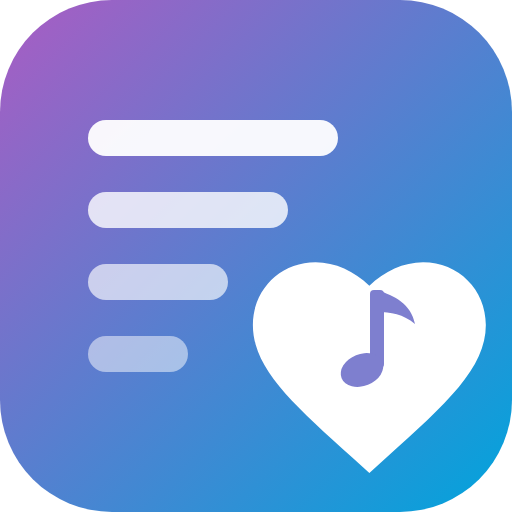

<p align="center"></p>

<h1 align="center">Auto Artist Playlists for Jellyfin</h1>

🇬🇧 [English](#english) · 🇩🇰 [Dansk](#dansk)

---

## English

A Jellyfin plugin that remembers the songs you actually listen to.

When you have played at least **70 %** of a song (configurable):

1. ❤️ The song is marked as a **favorite** for you.
2. 🎵 It is added to a **private playlist named after the artist**, e.g. `Katy Perry`. The playlist is created if it doesn't exist, and songs are never added twice.
3. ❤️ The artist playlist itself is marked as a favorite, so all of them show up under *Favorites*.

Remove the heart from a song and it is taken off the artist playlist again. Already have a library full of hearts? Run the **import** once (see below) to build the playlists from what you have.

The main artist is the first track artist, so `Katy Perry feat. Someone` goes to `Katy Perry`. If a track has no artist, the album artist is used. Playlists are private to each user.

Works with any client that reports playback to the server (web, Jellyfin Media Player / Desktop, Finamp, Android, iOS, …).

### Requirements

- Jellyfin **12.2** or newer

### Installation

**From the plugin repository (recommended)**

1. In Jellyfin go to **Dashboard → Plugins → Repositories** (or *Catalog → ⚙️*) and add:
   ```
   https://raw.githubusercontent.com/Tntdruid/jellyfin-plugin-auto-artist-playlists/main/manifest.json
   ```
2. Open the **Catalog**, find **Auto Artist Playlists** and install it.
3. Restart Jellyfin.

**Manual**

1. Download the latest `.zip` from [Releases](https://github.com/Tntdruid/jellyfin-plugin-auto-artist-playlists/releases).
2. Unzip it into a folder named `Auto Artist Playlists_<version>` inside Jellyfin's `plugins` folder:
   - Windows: `C:\ProgramData\Jellyfin\Server\plugins\`
   - Linux: `/var/lib/jellyfin/plugins/`
   - Docker: `/config/plugins/`
3. Restart Jellyfin.

### Upgrading from "Smart Play List"

Version 1.1 renamed the plugin from *Smart Play List* to *Auto Artist Playlists*. Your settings and playlists are kept. If you installed 1.0 manually, delete the old `Smart Play List_1.0.0.0` folder from `plugins` before installing 1.1.

### Settings

**Dashboard → Plugins → Auto Artist Playlists**

| Setting | Default | Description |
|---|---|---|
| Threshold (%) | 70 | How much of a song must be played before it counts |
| Mark the song with a heart | On | Marks the song as favorite |
| Mark the artist playlist with a heart | On | Marks the artist playlist as favorite |
| Remove the song when the heart is removed | On | Takes the song off the artist playlist. It is not added again for 24 hours |
| Also import songs I have played | Off | The import also includes every song Jellyfin has marked as played (your whole history) |
| Playlist name prefix | *(empty)* | E.g. `❤️ ` gives `❤️ Katy Perry` |
| Users | All | Limit the plugin to selected users |

The settings page is available in English and Danish and follows your Jellyfin display language. [Help translate it](#translations).

### Import existing songs

Go to **Dashboard → Scheduled Tasks → Auto Artist Playlists → Import existing songs** and run it once. It adds the songs you have already hearted to the artist playlists. Turn on *Also import songs I have played* first if you also want your whole play history imported. It is safe to run again; songs are never added twice.

### Tips

- Desktop and web clients may not show a newly created playlist or heart right away. Press **F5** to reload.
- The plugin writes to the Jellyfin log with the prefix `Auto Artist Playlists:`, which is useful when reporting issues.

### Building

```bash
dotnet publish Jellyfin.Plugin.AutoArtistPlaylists -c Release -o out
```

Copy `out/Jellyfin.Plugin.AutoArtistPlaylists.dll` into the plugin folder.

---

## Dansk

Et Jellyfin-plugin, der husker de sange, du faktisk hører.

Når du har hørt mindst **70 %** af en sang (kan ændres):

1. ❤️ Sangen markeres som **favorit** for dig.
2. 🎵 Den tilføjes til en **privat playliste med kunstnerens navn**, f.eks. `Katy Perry`. Playlisten oprettes, hvis den ikke findes, og sange tilføjes aldrig to gange.
3. ❤️ Selve kunstner-playlisten markeres som favorit, så de alle samles under *Favoritter*.

Fjerner du hjertet fra en sang, bliver den taget af kunstner-playlisten igen. Har du allerede mange sange med hjerte? Kør **importen** én gang (se nedenfor) for at bygge playlisterne ud fra dem.

Hovedkunstneren er den første kunstner på nummeret, så `Katy Perry feat. Nogen` havner på `Katy Perry`. Har nummeret ingen kunstner, bruges albumkunstneren. Playlisterne er private for hver bruger.

Virker med alle klienter, der rapporterer afspilning til serveren (web, Jellyfin Media Player / Desktop, Finamp, Android, iOS, …).

### Krav

- Jellyfin **12.2** eller nyere

### Installation

**Fra plugin-repository (anbefalet)**

1. Gå til **Dashboard → Plugins → Repositories** (eller *Katalog → ⚙️*) i Jellyfin og tilføj:
   ```
   https://raw.githubusercontent.com/Tntdruid/jellyfin-plugin-auto-artist-playlists/main/manifest.json
   ```
2. Åbn **Katalog**, find **Auto Artist Playlists** og installér det.
3. Genstart Jellyfin.

**Manuelt**

1. Hent den nyeste `.zip` under [Releases](https://github.com/Tntdruid/jellyfin-plugin-auto-artist-playlists/releases).
2. Pak den ud i en mappe med navnet `Auto Artist Playlists_<version>` i Jellyfins `plugins`-mappe:
   - Windows: `C:\ProgramData\Jellyfin\Server\plugins\`
   - Linux: `/var/lib/jellyfin/plugins/`
   - Docker: `/config/plugins/`
3. Genstart Jellyfin.

### Opgradering fra "Smart Play List"

I version 1.1 skiftede pluginet navn fra *Smart Play List* til *Auto Artist Playlists*. Dine indstillinger og playlister bevares. Har du installeret 1.0 manuelt, så slet den gamle mappe `Smart Play List_1.0.0.0` i `plugins`, før du installerer 1.1.

### Indstillinger

**Dashboard → Plugins → Auto Artist Playlists**

| Indstilling | Standard | Beskrivelse |
|---|---|---|
| Grænse (%) | 70 | Hvor meget af sangen der skal høres, før den tæller |
| Markér sangen med hjerte | Til | Markerer sangen som favorit |
| Markér kunstner-playlisten med hjerte | Til | Markerer kunstner-playlisten som favorit |
| Fjern sangen, når hjertet fjernes | Til | Tager sangen af kunstner-playlisten. Den tilføjes ikke igen de næste 24 timer |
| Importér også sange, jeg har hørt | Fra | Importen tager også alle sange med, som Jellyfin har markeret som afspillet (hele din historik) |
| Præfiks på playlistenavn | *(tom)* | F.eks. `❤️ ` giver `❤️ Katy Perry` |
| Brugere | Alle | Begræns pluginet til udvalgte brugere |

Indstillingssiden findes på dansk og engelsk og følger dit sprog i Jellyfin. [Hjælp med at oversætte](#translations).

### Importér eksisterende sange

Gå til **Dashboard → Planlagte opgaver → Auto Artist Playlists → Import existing songs** og kør den én gang. Den lægger de sange, du allerede har givet hjerte, på kunstner-playlisterne. Slå *Importér også sange, jeg har hørt* til først, hvis hele din afspilningshistorik også skal med. Den kan trygt køres igen; sange tilføjes aldrig to gange.

### Tips

- Desktop- og web-klienter viser ikke altid en ny playliste eller et nyt hjerte med det samme. Tryk **F5** for at genindlæse.
- Pluginet skriver i Jellyfins log med præfikset `Auto Artist Playlists:`, hvilket er nyttigt, hvis du vil rapportere en fejl.

### Byg selv

```bash
dotnet publish Jellyfin.Plugin.AutoArtistPlaylists -c Release -o out
```

Kopiér `out/Jellyfin.Plugin.AutoArtistPlaylists.dll` ind i plugin-mappen.

---

## Translations

The settings page follows the user's Jellyfin display language. Adding a language takes one block of text:

1. Open [`Configuration/configPage.html`](Jellyfin.Plugin.AutoArtistPlaylists/Configuration/configPage.html).
2. In `AutoArtistPlaylistsStrings`, copy the `en` block and change its key to the two-letter language code, e.g. `sv`, `nb` or `de`.
3. Translate the texts and open a pull request.

Languages without a block fall back to English.

---

## License / Licens

[GPL-3.0](LICENSE)
